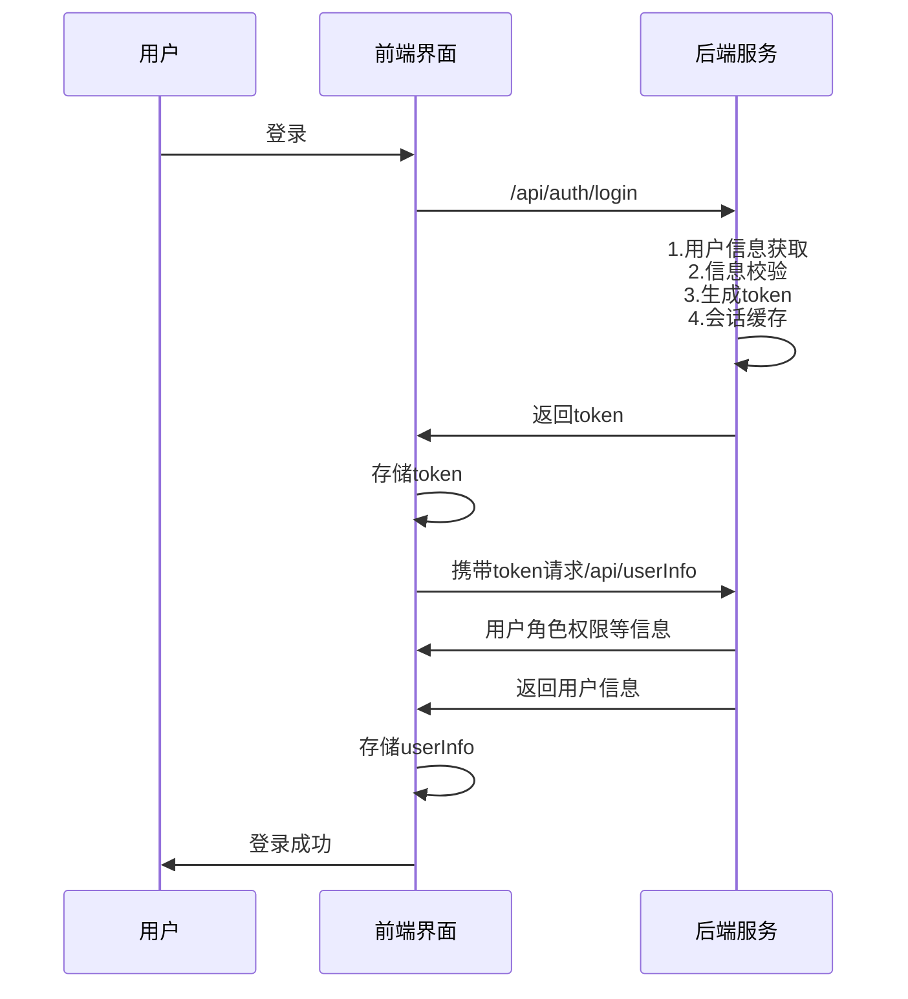

# 登录认证

::: tip
认证就是识别出来"你是谁"，是认证鉴权中的认证部分，可用`authN(Authentication)`表示。
登录认证包括：用户认证、颁发令牌、会话管理、用户信息缓存等功能。
:::

## 认证流程
用户登录通过`/auth/login`接口实现，登录接口的流程为: `login接口` -> `用户信息获取` -> `信息检查` -> `生成令牌` -> `缓存信息` -> `返回令牌`
登录完成之后，前端会把token令牌保存到浏览器本地，同时携带token获取用户信息，然后把用户信息保存在本地




<!--  -->

## 颁发令牌
用户登陆成功后，会颁发令牌返回给前端用于后续的权限验证。

通过`TokenService`进行令牌生成，该接口有两种实现，分别是`RedisTokenServiceImpl`和`JwtTokenServiceImpl`，两种令牌的类型可通过配置 `custom.auth.token-type` 进行切换

| 取值    | 说明              |
| ------- | ----------------- |
| `jwt`   | JWT令牌+redis缓存 |
| `redis` | Redis有状态认证   |

本系统中，两种类型的令牌格式不同，支持的功能并无差异。
本系统使用`SaToken`进行令牌生成，关于令牌的配置如有效期等可参考[SaToken官方文档](https://sa-token.com/use/config.html)。

## 用户信息缓存
生成令牌后会在redis中将用户的信息进行缓存，这些信息包括用户基本信息、权限信息、角色信息等，可参考对象`LoginUser`。后续过程中可通过令牌(token)可以获取这些信息，可参考`LoginUserUtils`。

**用户信息存储格式：**
```js {6-17} title="USER_INFO"
{
    "username": "superAdmin",
    "name": "超管小李",
    "orgCode": "11000000",
    "groupCode": "g_default",
    // 权限信息
    "roles": [
        "r_superAdmin",
        "r_default"
    ],
    "perms": [
        "sys:user:page",
        "sys:user:detail",
        "sys:org:page",
        "sys:org:detail",
        ...
    ],
    // 数据范围
    "dataScope": 1,
    ...
}
```

缓存的用户信息，特别是权限信息在后续的接口鉴权和数据权限控制的过程中还会用到，可参考后续`鉴权、权限`相关章节。

## 会话管理
用户登录后，用户信息保存在缓存中，因此可以进行会话管理，如在线状态、续签、强制下线等功能

## 认证接口

| 接口                      | 方法 | 说明       |
| ------------------------- | ---- | ---------- |
| `/api/auth/login`         | POST | 用户登录   |
| `/api/auth/login/captcha` | GET  | 获取验证码 |
| `/api/auth/logout`        | POST | 退出登录   |

请求头约定：

```
Authorization: Bearer <Token>
```
