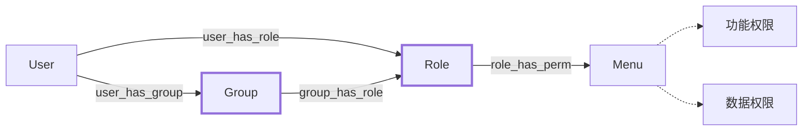

# 接口鉴权
::: tip
鉴权就是识别出来"你能做什么"，是认证鉴权中的鉴权部分，可用`authZ(Authorization)`表示。
权限管理就是控制用户可以访问那些资源，包括前端的菜单、页面、按钮以及后端的接口。
:::

## 权限模型
系统采用经典的 `RBAC（Role-Based Access Control）` 权限模型，同时使用了`角色组(Group)`的概念来增加权限管理的实用性，实现`用户-角色-权限`或`用户-岗位-角色-权限`的灵活访问控制，涵盖后端接口鉴权与前端菜单按钮权限。

### 核心概念

| 概念               | 说明                                             |
| ------------------ | ------------------------------------------------ |
| **用户(User)**     | 系统操作者，通过角色/角色组间接获得权限          |
| **角色(Role)**     | 一组资源权限的集合                               |
| **菜单(Menu)**     | 系统功能入口，如目录、菜单、按钮等，关联权限标识 |
| **权限标识(Perm)** | 功能权限的唯一标识，如`sys:user:add`             |
| **角色组(Group)**  | 一组角色的集合，本系统中用**岗位**表示           |

### 权限管理方式
权限管理时有以**角色为核心**和以**岗位为核心**两种不同的方式，可以按需使用

* 以**角色为核心**进行权限管理时，支持**一人多角色**，用户可同时具有多个角色的权限，无法进行角色切换。
* 以**岗位为核心**进行权限管理时，支持**一人多岗**、**一岗多角**，用户可以进行**岗位切换**，岗位切换后对应的权限也会变化。
* 两种形式同时使用时，将`用户-角色`关系直接当作**系统默认岗位**处理，可参与岗位切换。



多数系统通过角色控制权限已经足够了，两种使用方式的特点如下：

| 权限管理核心    | 权限链条              | 适用场景                   |
| --------------- | --------------------- | -------------------------- |
| **角色(Role)**  | `用户-角色-权限`      | 适用于大多数场景           |
| **岗位(Group)** | `用户-岗位-角色-权限` | 适用于如兼职岗位等复杂场景 |

## 前端权限

### 菜单权限
菜单即用户左侧菜单栏，控制用户可以打开哪个页面，菜单权限由前端的**动态路由**功能自动从后端接口`/userMenu`获取并渲染。

### 按钮权限

按钮权限控制用户可做什么操作，除了页面上是否显示、是否可点击之外，通过权限标识与接口绑定，决定了是否有接口的访问权限。
用户登录后通过`/userInfo`接口，从[用户信息缓存](http://localhost:5173/moyu-boot/auth-login.html#%E7%94%A8%E6%88%B7%E4%BF%A1%E6%81%AF%E7%BC%93%E5%AD%98)中获取权限信息并保存在本地的用户信息`USER_INFO`中，包含用户的权限相关字段`roles`和`perms`

**使用方式：**
前端页面中若要控制按钮是否显示、是否可点等权限可使用`@/utils/permission`中的函数`hasPerm`、`hasAnyPerm`、`hasRole`等

```js
import { hasPerm } from "@/utils/permission"
// js脚本中：
if (hasPerm(['sys:user:add'])) ...
// vue模板中：
<a-button v-if="hasPerm('sys:user:add') || hasRole(['admin'])">操作</a-button>
```

## 后端接口鉴权
本系统使用`Sa-Token`权限认证框架进行权限认证，支持全局配置鉴权和注解鉴权。

### 全局鉴权过滤器
本系统提供了一个全局鉴权过滤器，可会对接口进行登录鉴权检查(checkLogin)，可以通过配置进行控制

```yml
# 自定义配置
custom:
  # 自定义认证鉴权配置
  auth:
    # 是否启用鉴权，为false时等同于全加白
    enabled: true
    # 需要进行认证的列表，默认["/api/**"]
    auth-list:
      - /api/**
```

### 鉴权白名单
全局鉴权过滤器支持对部分接口加入白名单，跳过登录鉴权检查。

```yml
# 自定义配置
custom:
  # 自定义认证鉴权配置
  auth:
    # 白名单列表，默认为空列表[]
    white-list:
      # 认证授权类
      - /api/auth/login/**
      # 回调、远程调用类
      - /callback/**
```

### 注解鉴权
本系统支持`Sa-Token`的注解鉴权，常用的注解鉴权使用方式如下，更多可参考[Sa-Token官方注解](https://sa-token.cc/doc.html#/use/at-check)

* `@SaCheckLogin`: 登录校验，只有登录之后才能进入该方法。
* `@SaCheckRole("admin")`: 角色校验，必须具有指定角色标识才能进入该方法。
* `@SaCheckPermission("sys:user:page")`: 权限校验，必须具有指定权限才能进入该方法。

## 使用指南
对接口的访问控制，不同场景可采用不同策略

 | 场景                         | 实现方案                                                                                                                                                               |
 | ---------------------------- | ---------------------------------------------------------------------------------------------------------------------------------------------------------------------- |
 | `完全开放，无需登录即可访问` | 配置文件中添加白名单(`custom.auth.white-list`)                                                                                                                         |
 | `需要登陆才可访问`           | 默认策略，无需在接口上做任何控制                                                                                                                                       |
 | `拥有特定权限才可访问`       | 1.在接口上添加`@SaCheckPermission`等注解进行鉴权；<br>2.在按钮配置上设置对应的权限标识；<br>3.授权对应的的按钮权限；                                                   |
 | `控制特定接口的数据范围`     | 1.参考`数据权限`章节控制好数据范围；<br>2.在按钮配置上设置对应的权限标识；<br>3.创建对应的接口配置，并设置数据范围标识；<br>4.授权对应的的按钮权限，然后授权数据范围； |

## 最佳实践

1. 接口管理中，接口的唯一标识即为权限标识
2. 拥有接口权限后，若接口有数据范围，才可配置此接口的数据范围
3. 若无需控制接口的数据范围，可以不创建对应的接口配置

## 相关文件

| 文件                    | 说明                                 |
| ----------------------- | ------------------------------------ |
| `StpInterfaceImpl.java` | 加载用户角色权限信息的实现           |
| `LoginUserUtils.java`   | 登录用户工具类，用户获取登录用户信息 |
| `SaTokenConfigure.java` | SaToken配置类                        |


## 权限模型关系表

无论是功能权限还是数据权限，均通过关系表进行关联，其表结构如下：

```sql
-- 用户角色权限关系表
CREATE TABLE `sys_relation`
(
    `id`            BIGINT NOT NULL AUTO_INCREMENT COMMENT '主键id',
    `object_id`     VARCHAR(64)   DEFAULT NULL COMMENT '对象ID',
    `target_id`     VARCHAR(64)   DEFAULT NULL COMMENT '目标ID',
    `relation_type` TINYINT       DEFAULT NULL COMMENT '关系类型(字典 1:user_has_role,2:role_has_perm,3:user_has_group,4:group_has_role)',
    `ext_json`      TEXT          DEFAULT NULL COMMENT '扩展信息',
    ...
    PRIMARY KEY (`id`)
) CHARACTER SET = utf8mb4 COLLATE = utf8mb4_general_ci COMMENT = '用户角色权限关系表';
```